# Doctor Tracker

**Doctor Tracker is a secure admin web app for clinics.** Signed-in staff can manage doctors and the patients under each doctor, search and filter both lists by date, condition and other fields, and follow the clinic's numbers on an analytics dashboard: total doctors, total patients, patients per doctor and visit trends over time. A Next.js client talks to a standalone Express REST API backed by MongoDB, with indexes designed for each search, filter and pagination query.

- **Frontend:** Next.js 14 (App Router), Tailwind CSS, SWR, Recharts
- **Backend:** Node.js, Express 4 (standalone REST API), Zod validation, JWT auth
- **Database:** MongoDB 7 with Mongoose 8
- **DevOps:** Docker Compose (MongoDB + API + Next.js)

---

## Contents

1. [Features](#features)
2. [Setup guide](#setup-guide)
3. [System architecture](#system-architecture)
4. [Technical decisions](#technical-decisions)
5. [Visual evidence](#visual-evidence)
6. [API reference](#api-reference)
7. [Project structure](#project-structure)

---

## Features

| Area | What you get |
| --- | --- |
| **Authentication** | JWT login with bcrypt-hashed passwords, a rate-limited login endpoint, and the session checked on every request. Every API route except login requires a valid token, and every admin page waits for the session to be confirmed before rendering. |
| **Authorization** | Permissions (`dashboard`, `doctors`, `patients`) are defined in code and checked by `authorize()` middleware on each route, and by `RequirePermission` on each page. |
| **Doctors** | Create, edit and delete doctors (name, specialization, hospital, phone, email, plus status and join date). Search; filter by specialization, hospital, status and **join-date range**; sort; paginate. Each row shows the doctor's patient count. |
| **Doctor detail** | The doctor's profile plus **their patients**, with search, filters and pagination. You can **add patients under the doctor** and **remove patients from the doctor's list**. |
| **Patients** | A dedicated page listing every patient. Edit and delete patients. Search by name, phone, email or diagnosis. Filter by **visit-date range**, **condition**, gender, age group and doctor. Sort and paginate. |
| **Dashboard** | Total doctors, total patients, visits in the selected range with growth vs the previous period, critical patients, **patient visits over time** (7d / 30d / 90d / 12m), **patients per doctor**, patients by specialty, condition mix, age and gender breakdowns, and recent visits. |
| **App bar search** | A search box in the top bar finds doctors and patients as you type, in grouped results (↑/↓ to move, Enter to open, Ctrl/⌘ + K to focus). It reuses the normal list endpoints, so permissions and indexes apply as usual. |
| **Organized filters** | Every list has the same toolbar: search, a **Filters** panel with labelled fields, a sort control, and a removable chip for each active filter (plus "Clear all"). |
| **UX** | Modern, minimal design: flat cards, an icon in every input, short two-column forms. Responsive at every size (tables become cards on phones), filters kept in the URL (shareable, survive refresh), debounced search, skeleton loaders, toasts, confirm dialogs and inline validation errors. |

### Demo account

| Email | Password |
| --- | --- |
| `admin@doctortracker.dev` | `Admin@123` |

The seed creates **40 doctors** in 12 specialties and **1,800 patients** spread over the past year, so the charts and filters have realistic data.

---

## Setup guide

### Option A: Docker (recommended, one command)

Requirements: Docker Desktop.

```bash
git clone <repo-url> doctor-tracker
cd doctor-tracker
cp .env.example .env          # optional: every value has a safe local default
docker compose up -d --build
```

| URL | What |
| --- | --- |
| http://localhost:3000 | Admin portal (redirects to the login page) |
| http://localhost:4000/api/health | API health check |

On first start the API sees an empty database and seeds the demo data (`SEED_ON_START=true`). MongoDB is published on **localhost:27018**, so it doesn't clash with a local MongoDB on 27017.

```bash
docker compose logs -f server                                # API logs
docker compose exec server node src/seeders/run.js --fresh   # reset demo data
docker compose down                                          # stop (data is kept in a Docker volume)
docker compose down -v                                       # stop and delete all data
```

### Option B: Run locally with npm (for development)

Requirements: Node 18+ and Docker (for MongoDB only), or any MongoDB 6+ instance.

```bash
# 1. Database
docker compose up -d mongo              # MongoDB on localhost:27018

# 2. API (terminal 1)
cd server
cp .env.example .env                    # set a long random JWT_SECRET
npm install
npm run dev                             # http://localhost:4000 (seeds demo data on first run)

# 3. Client (terminal 2)
cd client
cp .env.example .env.local
npm install
npm run dev                             # http://localhost:3000
```

Useful scripts, both run in `server/`: `npm run seed` (fill empty collections) and `npm run seed:fresh` (wipe and re-seed).

### Environment variables

There are three `.env.example` files, one for each way of running the app:

| File | Used by | Variables |
| --- | --- | --- |
| [.env.example](.env.example) | `docker compose` | `JWT_SECRET`, `JWT_EXPIRES_IN`, `CLIENT_URL`, `PUBLIC_API_URL`, `MONGO_PORT`, `SEED_ON_START` |
| [server/.env.example](server/.env.example) | `npm run dev` in `server/` | `MONGO_URI`, `PORT`, `JWT_SECRET`, `JWT_EXPIRES_IN`, `CLIENT_URL` (CORS), `SEED_ON_START` |
| [client/.env.example](client/.env.example) | `npm run dev` in `client/` | `NEXT_PUBLIC_API_URL` (browser → API), `NEXT_PUBLIC_SITE_URL` |

> **Production:** set a long random `JWT_SECRET`, set `SEED_ON_START=false` once real data exists, and set `CLIENT_URL` / `PUBLIC_API_URL` to your real domains.

---

## System architecture

```
                 ┌──────────────────────── Next.js client (client/) ────────────────────────┐
  Admin ────────►│ app/admin/login        → POST /auth/login → JWT saved in localStorage     │
                 │ app/admin/(panel)/*    → AuthProvider confirms the session (GET /auth/me) │
                 │   Client Components → SWR (hooks/useApi.js) → services/api.js + Bearer JWT │──┐
                 │   filters/page live in the URL (hooks/useUrlFilters.js)                    │  │ REST / JSON
                 └────────────────────────────────────────────────────────────────────────────┘  │
                                                                                                 ▼
                 ┌──────────────────────── Express API (server/) ─────────────────────────────┐
                 │ helmet · cors · compression · login rate limit                              │
                 │ route → authenticate (JWT) → authorize(permission) → controller             │
                 │       controller → Zod validator → service (queries / aggregations) → model │
                 │ /api/auth  /api/dashboard  /api/doctors  /api/patients                      │
                 │ errorHandler → consistent { message, errors[] } responses                   │
                 └──────────────────────────────────────┬──────────────────────────────────────┘
                                                        │ Mongoose
                                                        ▼
                 ┌──────────────────────────── MongoDB ────────────────────────────────────────┐
                 │ doctors · patients · users                                                   │
                 │ compound indexes for each filter + sort combination                          │
                 └──────────────────────────────────────────────────────────────────────────────┘
```

### Request flow, for example "patients filtered by condition"

1. Changing the filter updates the URL (`?condition=critical&page=1`) through `useUrlFilters`.
2. SWR requests `GET /api/patients?condition=critical&page=1`. It keeps the previous page visible (dimmed) while loading, so the table doesn't flash.
3. Express checks the JWT (`authenticate`) and the `patients` permission (`authorize`), then builds the Mongo filter.
4. `find().sort().skip().limit()` and `countDocuments()` run **in parallel**, both using the `{ condition: 1, visitDate: -1 }` index. A single `populate` (one `$in` query) adds the doctor names.
5. The API responds with `{ items, meta: { total, page, limit, pages } }`.

---

## Technical decisions

### 1. Why SWR + URL search params instead of Redux (or a big Context)

Almost all state in this app is **server state**: lists, totals and records that live in MongoDB. The only real client state is "which filters and page am I looking at?".

- **Filters live in the URL** ([client/src/hooks/useUrlFilters.js](client/src/hooks/useUrlFilters.js)). Refresh, back/forward and sharing a link all keep the exact view. For example, the dashboard's "View critical patients" is just a link to `/admin/patients?condition=critical`. Changing any filter resets to page 1, and default values are left out to keep URLs clean.
- **SWR owns server data.** The cache key is `[path, params]`, so every filter combination is cached separately and going back to page 1 is instant. Identical requests are de-duplicated (two components asking for `/doctors/options` make one request). `keepPreviousData` keeps the old rows visible while the next page loads. After a write we call `mutate()` on the affected list instead of hand-updating a global store.
- **Context only for auth.** `AuthProvider` holds the signed-in user and a memoised `can(permission)` helper. That value rarely changes, so it doesn't cause re-renders.

Redux would have meant writing actions, reducers, loading flags and cache invalidation by hand for data SWR already handles, and would have added a store that duplicates the URL. **Trade-off:** there is no single global state tree to inspect, but each page is easier to read: its state is its URL plus the data for that URL.

Re-renders are kept down with `React.memo` table rows and `useCallback` handlers (editing one row doesn't re-render the others), a 350 ms debounced search, and lazily loaded charts (`next/dynamic`), so Recharts is only downloaded on the dashboard.

### 2. Why the query and index design looks the way it does (MongoDB)

Every list screen is "filter by X, sort by date, return page N", so the indexes are **compound indexes ordered `{ filterField, dateField }`**:

| Collection | Index | Serves |
| --- | --- | --- |
| patients | `{ doctor: 1, visitDate: -1 }` | a doctor's patient list; the patients-per-doctor `$group`; per-page patient counts |
| patients | `{ condition: 1, visitDate: -1 }` | condition filter + newest-first sort |
| patients | `{ gender: 1, visitDate: -1 }`, `{ visitDate: -1 }` | gender filter; date-range filter and dashboard time series |
| doctors | `{ specialization: 1, joinedAt: -1 }`, `{ hospital: 1, joinedAt: -1 }`, `{ status: 1, joinedAt: -1 }`, `{ joinedAt: -1 }`, `{ name: 1 }`, `email` (unique) | each doctor filter + default sort, name sort, filter dropdowns via `distinct` |

When the index matches both the filter and the sort, MongoDB reads documents in order and stops after `limit`; it never sorts in memory. Verified with `explain('executionStats')` on the seeded data:

```
patients by condition : condition_1_visitDate_-1      docsExamined=10   (page size 10)
patients of a doctor  : doctor_1_visitDate_-1         docsExamined=10
patients date range   : visitDate_-1                  docsExamined=10
doctors by specialty  : specialization_1_joinedAt_-1  docsExamined=4
```

Other query patterns:
- **No N+1 queries.** The doctors list gets the patient counts for a whole page with **one** `$group` over `{ doctor }` instead of one count per row. Patient lists use one `populate` (`$in`) for doctor names.
- **The dashboard is a handful of parallel queries**, not dozens. One `$facet` returns the condition, gender, age-bucket (`$bucket`) and critical-count breakdowns in a single round trip. `$dateTrunc` groups the time series by day, week or month, and empty buckets are filled in JavaScript so charts don't skip days. Totals use `estimatedDocumentCount()`, which reads collection metadata.
- **Lean reads:** list endpoints use `.lean()` to skip building Mongoose documents.
- **Search** is a case-insensitive "contains" match with the user's text escaped as a regex. It is combined with the indexed filters, so it scans only within an already-narrowed range. *Trade-off:* a leading-wildcard regex can't use an index on its own. For a few thousand records per clinic it is instant and supports partial words ("card" finds "Cardiology"), which a `$text` index doesn't. At a much larger scale the plan is MongoDB Atlas Search, which only changes `searchFilter()` in [server/src/utils/queryFilters.js](server/src/utils/queryFilters.js).
- **Pagination** uses `skip/limit` with a parallel `countDocuments`, because the UI needs page numbers and a total. For very deep pages, keyset ("after this date") pagination would be the upgrade path.

### Smaller decisions worth knowing

- **Validation in one place:** one Zod schema file per resource ([server/src/validators](server/src/validators)) returns `422 { message, errors: [{ path, message }] }`, and the client's `useForm` maps those errors onto the matching fields. Malformed ids return 400 before any query runs (`router.param` + `validateObjectId`), and duplicate emails return 409.
- **Security:** helmet, CORS limited to `CLIENT_URL`, a login rate limit (20 per 15 min), and the API never returns password hashes. Changing the password signs out every other session (`passwordChangedAt`). Deleting a doctor who still has patients is refused (409), so no patient is left without a doctor.
- **Permissions are code, not data** ([server/src/constants/roles.js](server/src/constants/roles.js)): adding a role or permission is a one-line change with no migration.
- **JWT in `localStorage` (Bearer header):** this keeps the API stateless and lets the client and API run on different domains without cross-site cookie setup. The trade-off is exposure to XSS, which React's escaping and a short token lifetime (`JWT_EXPIRES_IN=1d`) reduce. An httpOnly cookie on a shared parent domain is the upgrade path.

---

## Visual evidence

All screenshots are from the seeded demo, captured at 1440×900 (desktop) and 390×844 (mobile). The files are in [docs/screenshots](docs/screenshots).

### Login
| Desktop | Mobile |
| --- | --- |
| 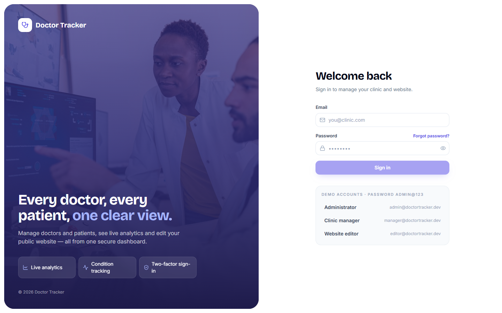 | 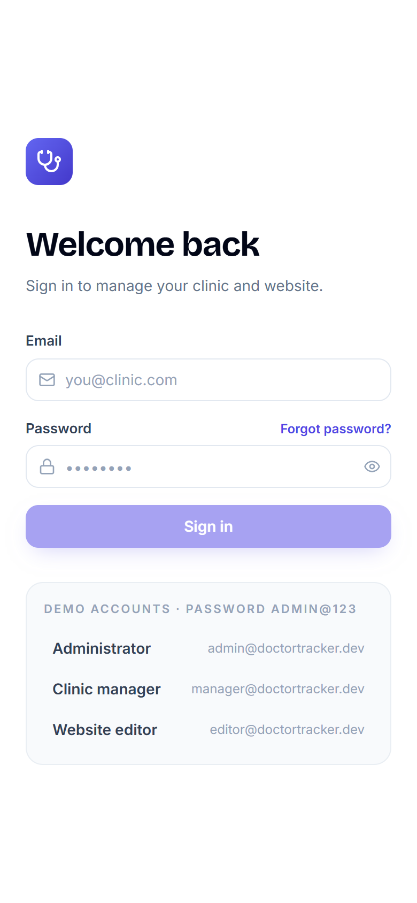 |

### Dashboard
| Desktop | Mobile |
| --- | --- |
| 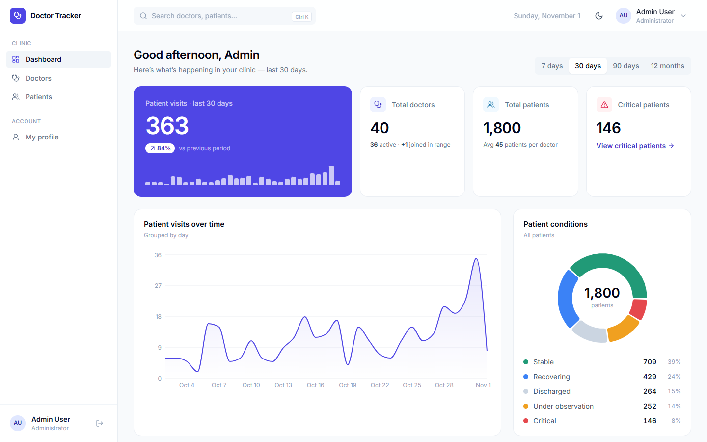 | 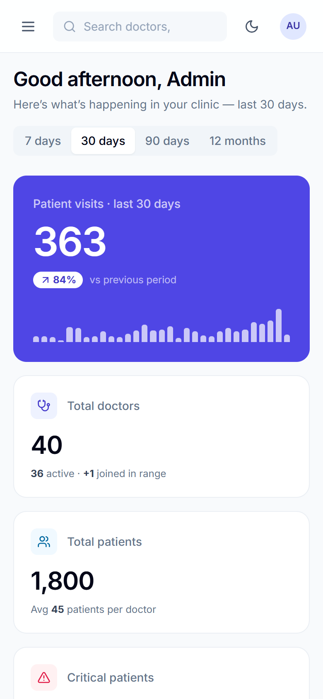 |

### Doctors: list and detail with that doctor's patients
| Desktop | Mobile |
| --- | --- |
| 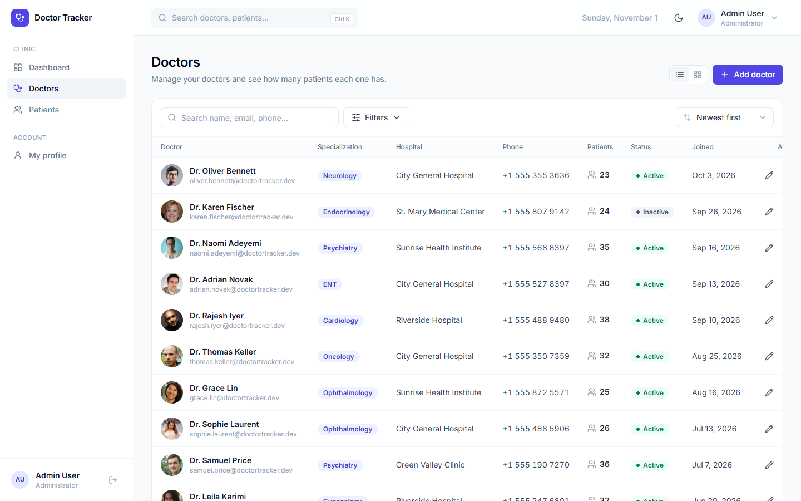 | 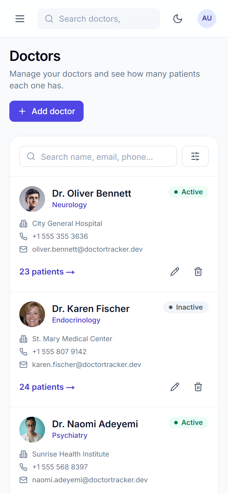 |
| 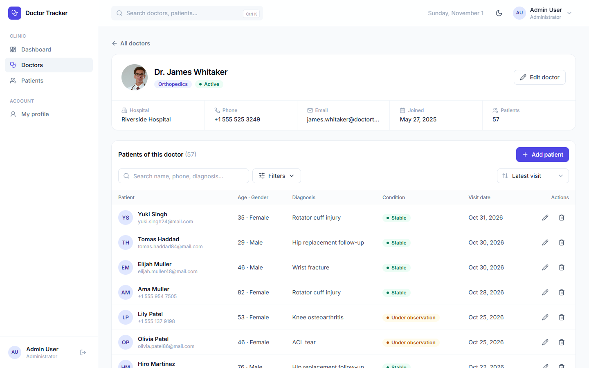 | 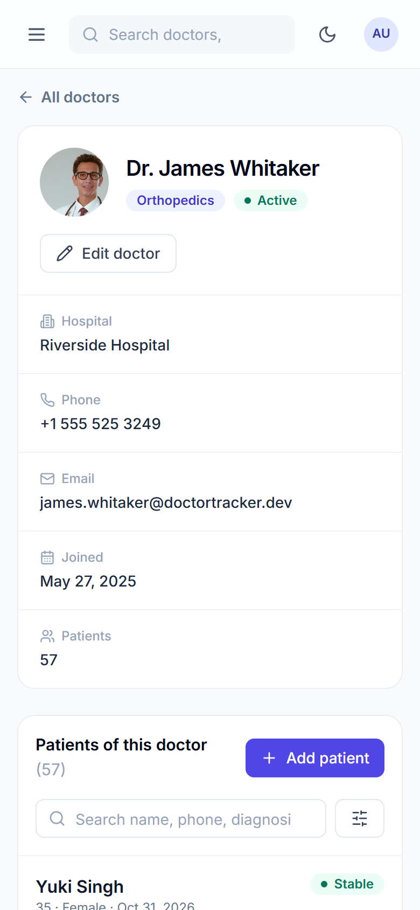 |

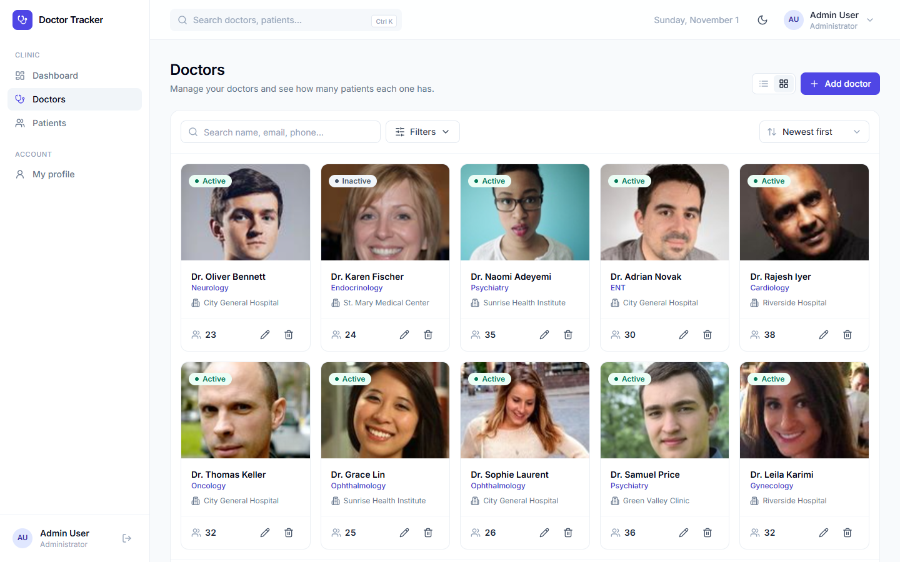

### Patients (filtered to critical)
| Desktop | Mobile |
| --- | --- |
| 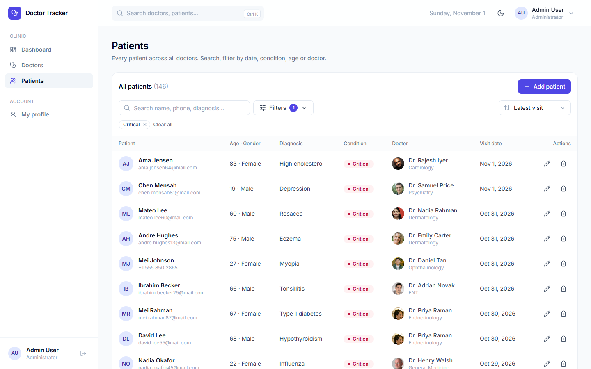 | 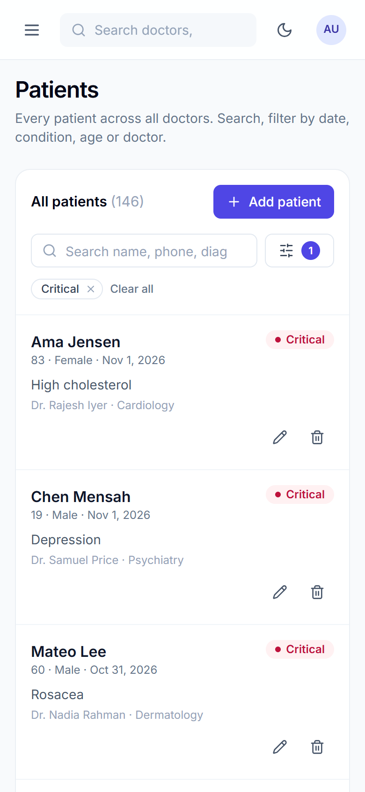 |

---

## API reference

All responses are JSON. Errors always look like `{ "message": "…", "errors"?: [{ "path", "message" }] }`. Lists return `{ items, meta: { total, page, limit, pages } }` and accept `page` and `limit` (max 100).

| Method & path | Permission | Notes |
| --- | --- | --- |
| `POST /api/auth/login` | public (rate-limited) | `{ email, password }` → `{ token, user }` |
| `GET /api/auth/me` · `PUT /api/auth/me` · `PUT /api/auth/me/password` | signed in | profile; password change returns a fresh token |
| `GET /api/dashboard?range=7d\|30d\|90d\|12m` | dashboard | all analytics in one response |
| `GET /api/doctors` | doctors | `q, specialization, hospital, status, from, to, sort=newest\|oldest\|name` |
| `GET /api/doctors/filters` · `GET /api/doctors/options` | doctors · doctors or patients | dropdown values |
| `POST /api/doctors` · `GET/PUT/DELETE /api/doctors/:id` | doctors | delete returns 409 while the doctor has patients |
| `GET/POST /api/doctors/:id/patients` · `DELETE /api/doctors/:id/patients/:patientId` | doctors | a doctor's patients |
| `GET /api/patients` | patients | `q, condition, gender, doctor, from, to, minAge, maxAge, sort=newest\|oldest\|name\|age` |
| `POST /api/patients` · `GET/PUT/DELETE /api/patients/:id` | patients | |

---

## Project structure

- **API (layered):** a request flows **route → middleware → controller → service → model**, and each layer has one job:

| Layer | Job | Example |
| --- | --- | --- |
| `routes/` | URL + HTTP method → middleware + controller. No logic. | `router.route('/:id').get(getPatient)` |
| `middlewares/` | Cross-cutting checks: JWT, permissions, rate limit, id format, errors | `authorize('patients')` |
| `controllers/` | Read the request, validate it, call a service or model, send the response | `createPatient` |
| `validators/` | Zod schemas, one file per resource | `patientSchema` |
| `services/` | Reusable query and business logic shared by several controllers | `listPatients`, `getDashboardStats` |
| `models/` | Mongoose schemas and **indexes** | `Patient` |

- **Client:** standard Next.js `src/` layout. Pages live in `app/`, reusable pieces in `components/` (grouped by feature), plus hooks, context, services (API calls), config and constants.

```
doctor-tracker/
├── docker-compose.yml               MongoDB + API + client
├── .env.example                     variables for docker compose
├── docs/screenshots/                README images (desktop & mobile)
│
├── server/                          Express REST API
│   ├── Dockerfile
│   ├── .env.example
│   └── src/
│       ├── server.js                entry: connect DB → seed if empty → listen
│       ├── app.js                   Express app: security middleware, /api routes, error handler
│       ├── config/                  environment variables (read in one place), MongoDB connection
│       ├── constants/               roles & permissions, patient conditions & genders
│       ├── routes/                  index.js mounts auth, dashboard, doctor, patient routes under /api
│       ├── middlewares/             auth (JWT + authorize), error, rateLimit, validateObjectId
│       ├── controllers/             auth, dashboard, doctor, patient
│       ├── validators/              Zod schemas per resource (+ common pieces)
│       ├── services/                dashboard, doctor, patient
│       ├── models/                  Doctor, Patient, User
│       ├── utils/                   HttpError, asyncHandler, pagination, queryFilters, permissions
│       └── seeders/                 seedIfEmpty / seedFresh, CLI (npm run seed), demo data generator
│
└── client/                          Next.js 14 admin portal
    ├── Dockerfile                   multi-stage build, standalone output
    ├── .env.example
    ├── public/images/               doctor portraits used by the demo data, login photo
    └── src/
        ├── app/                     routes (App Router)
        │   ├── admin/login/
        │   ├── admin/(panel)/       dashboard, doctors, doctors/[id], patients, profile
        │   └── layout.js, page.js (→ /admin), globals.css, robots.js, not-found.js
        ├── components/
        │   ├── ui/                  Badge, Input, Modal, Pagination, Select, StatCard… (one file each)
        │   ├── layout/              AdminShell (sidebar + header), GlobalSearch (app bar search)
        │   ├── auth/                RequirePermission, AuthLayout
        │   ├── common/              FilterBar (+ FilterField, DateRange)
        │   ├── dashboard/           Charts (Recharts), TopDoctors (patients-per-doctor ranking)
        │   ├── doctors/             DoctorForm
        │   └── patients/            PatientForm, PatientsTable
        ├── context/                 AuthContext (signed-in user + can(permission))
        ├── hooks/                   useApi (SWR), useUrlFilters, useDebounce, useForm
        ├── services/                api.js (browser → API)
        ├── config/                  navigation.js (sidebar links)
        ├── constants/               labels & colours for conditions, genders, roles, sorts
        └── lib/                     utils (formatting helpers)
```

> **Image credits:** doctor portraits and the login photo are from [Unsplash](https://unsplash.com/license) and [randomuser.me](https://randomuser.me/), stored in `client/public/images` so the demo works offline.
